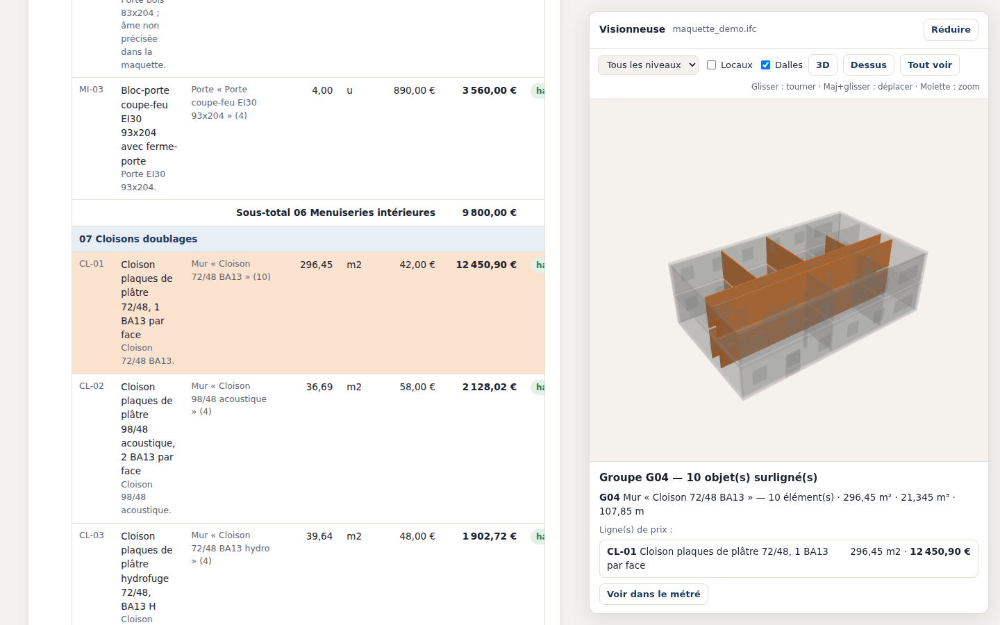
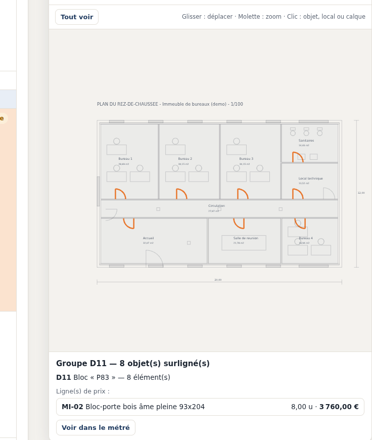
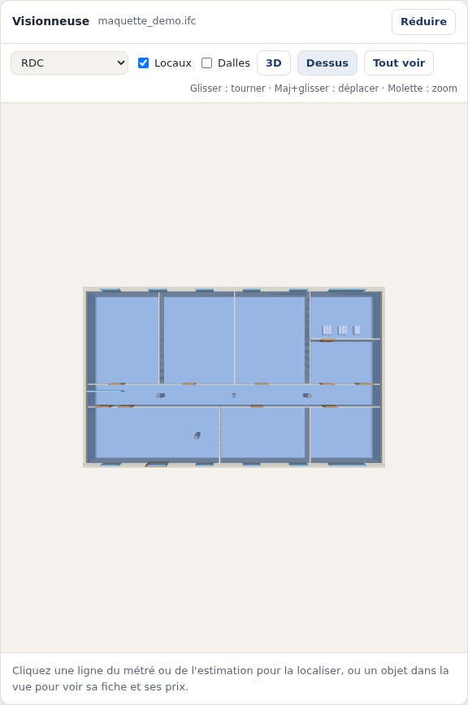

# SurveIA

**De la maquette BIM au chiffrage, en quelques minutes.** Une preuve de concept (POC) qui lit une maquette IFC ou un plan DXF/DWG, calcule le métré, puis confie à une IA (DeepSeek) la partie fastidieuse du travail de l'économiste : associer chaque ouvrage à la bonne ligne d'une bibliothèque de prix, en s'appuyant sur le CCTP. Une visionneuse 3D/2D permet de localiser chaque ligne de prix dans la maquette.

> **Principe clé : l'IA ne calcule aucune quantité et n'invente aucun prix.** Le métré est fait par le code, à partir des quantités IFC ou de la géométrie du plan. Les prix viennent uniquement de la bibliothèque fournie. Chaque calcul est affiché et traçable, et l'estimation est à relire par un économiste.



## Ce que fait l'application

1. **Clé API DeepSeek** : demandée au lancement, gardée en mémoire seulement, jamais écrite sur le disque.
2. **Sources** :
   - une maquette **IFC** (IFC2x3 ou IFC4) ou un plan **DXF / DWG** ;
   - un **CCTP** facultatif (PDF, Word `.docx` ou texte) ;
   - une **bibliothèque de prix** (CSV).
3. **Métré**, calculé par le code sans IA.
   - **IFC** : jeux de quantités (`Qto_*`) regroupés par type, locaux (IfcSpace) et appareils sanitaires.
   - **Plans** : longueurs par calque, surfaces des contours et hachures, nombre de blocs (y compris imbriqués et dynamiques), locaux repérés par leur nom.
4. **Estimation** : DeepSeek choisit la ou les lignes de prix de chaque ouvrage, avec un niveau de confiance et une justification. S'il y a un CCTP, il cite les articles et signale les **écarts maquette / CCTP**. Il liste aussi les **ouvrages décrits au CCTP mais non modélisés**.
5. **Export Excel** : lots, sous-totaux, TVA et TTC, avec les formules conservées. Les prix se modifient dans l'onglet bibliothèque, et les quantités manquantes sont à saisir sur fond jaune.
6. **Questions libres** sur le chiffrage : « Quel impact si on passe les fenêtres en PVC ? », etc.
7. **Visionneuse** : cliquez une ligne pour voir les objets concernés, ou un objet pour voir sa fiche et ses prix.

| Visionneuse 2D (plan DXF) | Vue en plan d'un niveau (IFC) |
|---|---|
|  |  |

## Installation

Il faut **Python 3.9 ou plus récent**. Aucun autre logiciel n'est nécessaire, et la visionneuse 3D fonctionne hors ligne.

```bash
git clone https://github.com/halhee/SurveIA.git
cd SurveIA
python3 -m pip install -r requirements.txt
python3 chiffrage_ia.py
```

Le navigateur s'ouvre sur `http://127.0.0.1:8765`. Gardez la fenêtre du Terminal ouverte, et arrêtez avec `Ctrl+C`.

- **Mac** : double-cliquez sur `lancer_mac.command`. La première fois, faites clic droit > Ouvrir pour passer l'avertissement de macOS.
- **Windows** : double-cliquez sur `lancer_windows.bat`.
- **Vérifier l'installation sans clé API** : `python3 chiffrage_ia.py --diagnostic` (ou `diagnostic_mac.command`).

Une clé API DeepSeek se crée sur [platform.deepseek.com](https://platform.deepseek.com). Tout le reste (métré, visionneuse, démos) fonctionne sans clé.

## Démonstration

Les fichiers de démo décrivent un même petit immeuble de bureaux R+1, **entièrement fictif** :

| Fichier | Contenu |
|---|---|
| `maquette_demo.ifc` | Maquette IFC4 : 100 éléments et 18 locaux |
| `plan_RDC_demo.dxf` | Le rez-de-chaussée en DXF, avec calques, blocs et locaux |
| `CCTP_demo.pdf` | Un CCTP de 3 pages. Il contient **volontairement** des contradictions avec la maquette et des ouvrages non modélisés |
| `bibliotheque_prix.csv` | 33 prix **fictifs** |

Scénarios conseillés :

1. **Maquette + CCTP** : les articles cités et les écarts apparaissent en rouge. Dans l'Excel, saisissez 28 m³ de fondations : le total se met à jour.
2. **Plan DXF + CCTP** : le même bâtiment en 2D.
3. **Effet mémoire** : relancez le calcul ou changez la hauteur des murs. Le résultat est instantané, sans nouvel appel à l'IA.

## Utiliser vos propres données

- **Bibliothèque de prix** : un CSV séparé par `;` ou `,`, avec les colonnes `code ; lot ; designation ; unite ; prix_unitaire_ht`. Unités reconnues : `m2`, `m3`, `ml`, `u`, `ens`, `ft`.
- **Revit** : dans l'export IFC, cochez **« Exporter les quantités de base »**, et exportez les pièces pour chiffrer sols et plafonds.
- **Plans** : nommez clairement vos calques (`A-MUR-BA20`, `A-CLOISON-72`…), utilisez des blocs pour les portes et fenêtres, et des polylignes fermées pour les locaux.
- **DWG** : enregistrez le plan en DXF, ou installez le convertisseur gratuit [ODA File Converter](https://www.opendesign.com/guestfiles/oda_file_converter). La conversion devient alors automatique.
- **CCTP** : un PDF avec du texte (pas un scan), ou un `.docx`.

## Confidentialité

L'API DeepSeek est hébergée en Chine. Voici ce qui lui est envoyé :

- les **noms** de types, calques, blocs et matériaux, avec les quantités mesurées ;
- les désignations de la bibliothèque de prix ;
- **le texte complet du CCTP**, s'il est fourni.

Les fichiers IFC et DXF eux-mêmes ne sont jamais envoyés. **Vérifiez que c'est compatible avec vos engagements de confidentialité**, en particulier pour le CCTP. Voir aussi [SECURITY.md](SECURITY.md).

## Architecture

| Fichier | Rôle |
|---|---|
| `chiffrage_ia.py` | Serveur local, lecture IFC et métré, appels à l'IA, estimation, export Excel |
| `lecture_dxf.py` | Lecture DXF (et DWG par conversion) : métré 2D et dessin pour la visionneuse |
| `lecture_cctp.py` | Lecture des CCTP (PDF, `.docx`, `.txt`) |
| `geometrie_ifc.py` | Formes 3D des éléments IFC : extrusions, polyèdres, maillages IFC4, types partagés, découpes |
| `interface.html`, `visionneuse.js` | Interface web et visionneuse (WebGL 2 pour la 3D, SVG pour les plans), sans bibliothèque externe |
| `outils/` | Générateurs des fichiers de démo (reproductibles à l'octet près) |
| `tests/` | Tests de bout en bout contre un faux DeepSeek local |

Dépendances : `openpyxl` (Excel) et `pypdf` (CCTP en PDF). Les lecteurs IFC et DXF et la 3D sont écrits sans dépendance.

## Tests

```bash
python3 tests/test_bout_en_bout.py          # 46 vérifications, moins d’une minute
```

Les tests n'ont besoin **ni de clé API ni de réseau**. Un faux DeepSeek local (`tests/faux_deepseek.py`) imite le modèle, y compris ses défauts : réponses tronquées, groupes oubliés, paramètre refusé. Sont vérifiés :

- le métré et l'estimation ;
- les montants de l'Excel ;
- la mémoire des correspondances ;
- la sécurité (requêtes d'autres sites refusées) ;
- la visionneuse ;
- une maquette d'environ 80 Mo.

## Limites connues

C'est un POC, pas un outil de production :

- une seule source de métré à la fois (maquette **ou** plan) ;
- plans 2D : ouvertures non déduites des murs ; les fenêtres ne donnent qu'un nombre ;
- visionneuse : réservations non percées ; formes NURBS et révolutions non dessinées (elles restent dans le métré) ;
- DXF binaire et PDF scannés non lus ;
- les correspondances proposées par l'IA doivent être relues par un économiste.

Voir [CHANGELOG.md](CHANGELOG.md) pour l'historique des versions.

## Licence

Distribué sous licence Apache 2.0 : voir [LICENSE](LICENSE).
